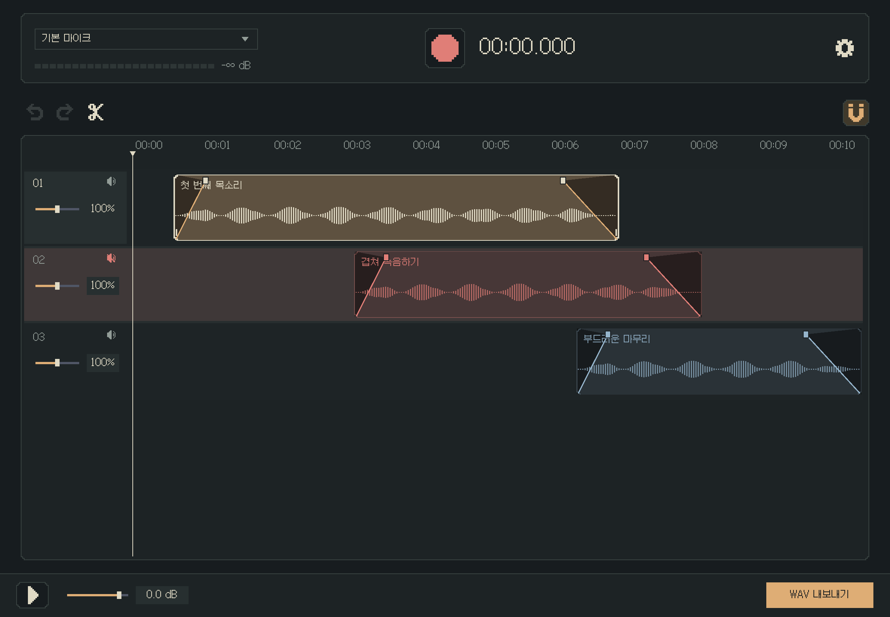
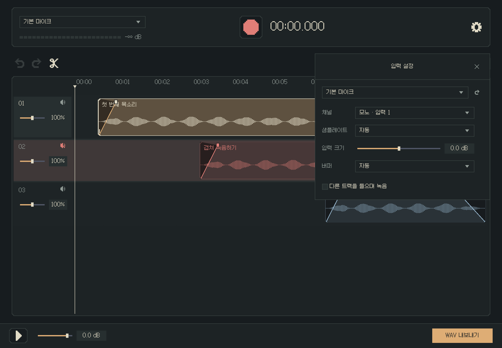
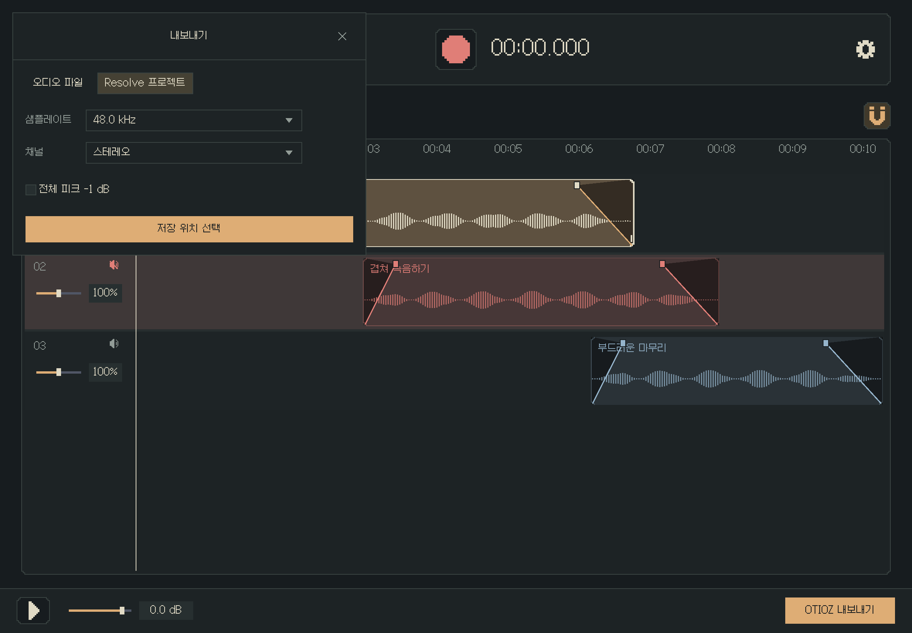

# DOTAPE

작은 도트 녹음기. Rust 네이티브 오디오 편집기입니다.

[Windows 다운로드](https://github.com/moveout824/dotape/releases/latest) · [디자인 원칙](docs/DESIGN.md)



예시 화면은 합성 오디오를 사용합니다. 녹음 파일과 개인 작업 데이터는 저장소에 포함하지 않습니다.

## 사용

Windows x64 ZIP을 풀고 `DOTAPE.exe`를 실행하세요. 갈무리 글꼴과 인코더를 포함하므로 따로 설치하지 않아도 됩니다.

마이크를 고르고 가운데 녹음 버튼을 누릅니다. 녹음한 클립은 마우스로 옮기고, 자르고, 겹쳐 놓을 수 있습니다. 트랙 수에는 제한을 두지 않았습니다. 클립을 위아래 빈 공간에 놓으면 트랙이 생기고, 비면 자동으로 정리합니다.

| 조작 | 동작 |
|---|---|
| 빈 공간 드래그 | 다중 선택과 재생선 이동을 함께 수행 |
| Ctrl+클릭 | 선택 추가·해제 |
| 선택한 클립 드래그 | 함께 이동 |
| 시간 눈금 드래그 | 재생선 이동, 화면 밖으로 끌면 따라가기 |
| 휠 회전 | 마우스 위치를 기준으로 확대·축소 |
| 휠 버튼을 누르고 드래그 | 가로·세로 화면 이동 |
| 클립 중앙 선 드래그 | 클립 볼륨 조절, 호버할 때만 선 표시 |
| 위쪽 손잡이 드래그 | 페이드, 서로 닿으면 반대쪽 길이를 밀어냄 |
| 아래쪽 끝 드래그 | 녹음 원본 범위 안에서 길이 다듬기 |
| 트랙·클립 더블클릭 | 이름 변경 |
| 숫자·슬라이더·볼륨 선 더블클릭 | 기본값 복귀 |

선택한 클립은 밝게, 음소거한 트랙은 붉게 표시합니다. 트랙 배경은 명암을 번갈아 쓰며 그리드는 표시하지 않습니다. 클립의 원래 양끝은 계단형, 잘라낸 면은 직각입니다.

| 키 | 동작 |
|---|---|
| R | 녹음 시작·정지 |
| Space | 재생·일시정지, 녹음 중에는 정지 |
| Ctrl+B | 재생선에서 분할 |
| Ctrl+J | 같은 원본의 연속 구간 이어붙이기 |
| Ctrl+C / V | 선택 클립 복사·붙여넣기 |
| Ctrl+Z / Ctrl+Shift+Z | 실행 취소·다시 실행 |
| N | 정렬 자석 토글 |
| Alt+드래그 | 자석을 잠시 해제 |
| Delete / Backspace | 선택 클립 삭제 |
| Home | 처음으로 |
| Ctrl+E | 내보내기 |

자석은 모든 트랙의 클립 시작과 끝에 맞춥니다. 잡힌 위치는 빨간 선으로 표시합니다. 같은 트랙에 클립을 놓으면 겹친 부분을 덮어쓰고, 남은 원본 구간은 보존합니다. 다른 트랙의 소리는 함께 들립니다.

## 설정과 저장



설명은 마우스를 1.5초 멈추면 나타납니다. 설정은 즉시 적용합니다. 마이크 하나로 목소리를 녹음한다면 모노 입력 1과 기기 자동 설정부터 사용해 보세요.

‘오디오 파일’은 WAV·MP3·FLAC·OGG Vorbis 하나로 합쳐 저장합니다.



‘Resolve 프로젝트’는 트랙·클립 배치와 오디오를 **`.otioz` 한 파일**에 담습니다. DaVinci Resolve 18.5 이상에서 **파일 → 가져오기 → 타임라인**으로 열면 트랙과 컷이 나뉜 타임라인으로 가져옵니다. 미디어가 파일 안에 들어 있어 원본 녹음 폴더를 따로 복사하지 않아도 됩니다. [Blackmagic의 OTIO 안내](https://documents.blackmagicdesign.com/se/SupportNotes/DaVinci_Resolve_18.5_New_Features_Guide.pdf?_v=1681801210000)

프로젝트의 클립 오디오는 32 bit float WAV로 저장합니다. 클립·트랙·전체 볼륨과 페이드는 오디오에 반영합니다. Resolve에서 각 클립을 옮기거나 자를 수 있지만 DOTAPE의 페이드 손잡이와 볼륨 값이 별도 조절값으로 옮겨지지는 않습니다. 음소거한 트랙도 미디어와 비활성 상태를 함께 담습니다. 편집 시각은 오디오 샘플 단위로 기록하며, 가져온 뒤의 표시·편집 단위는 Resolve 타임라인 설정을 따릅니다.

‘전체 피크 -1 dB’를 켜면 믹스 전체에 같은 배율을 적용하므로 미리듣기와 최종 크기가 달라질 수 있습니다. 프로젝트의 클립에도 같은 배율을 씁니다. 32 bit float WAV는 믹스에서 0 dB를 넘는 값도 보존합니다.

원본 WAV와 마지막 편집은 `%LOCALAPPDATA%\Sori`에 자동 저장합니다. 이전 버전의 작업을 이어 쓰도록 데이터 경로를 유지했습니다. 설정 아이콘을 오른쪽 클릭하면 녹음 폴더를 엽니다. 삭제한 클립의 원본은 디스크에 남습니다.

긴 녹음은 길이에 비례해 메모리를 사용합니다. 다른 샘플레이트로 내보낼 때는 변환용 메모리가 추가로 필요합니다. WAV는 4 GB 한도가 있으므로 그보다 큰 출력에는 FLAC 등을 사용하세요.

### 다른 프로그램에서 쓰기

영상 편집기 같은 다른 프로그램(예: DOTRACK)이 DOTAPE를 녹음기로 불러 쓸 수 있습니다. DOTAPE는 호스트를 알지 못하며, 환경 변수 세 개와 파일 하나로만 이야기합니다. 아무것도 설정하지 않으면 평소와 같습니다.

| 이름 | 역할 |
|---|---|
| `SORI_DATA_DIR` | 작업과 원본 WAV를 저장할 폴더. 녹음은 `recordings\take-*.wav`로 남습니다. |
| `SORI_EXPORT_DIR` | 내보내기 대화상자가 처음 여는 폴더. 없으면 만듭니다. 한 번 저장한 뒤에는 마지막 저장 폴더를 우선합니다. |
| `SORI_HOST` | 호스트 이름. 설정하면 하단에 ‘녹음이 끝나면 창을 닫으세요’ 안내와 내보내기 폴더를 표시하고, 설정 아이콘 오른쪽 클릭 메뉴에 ‘내보내기 폴더 열기’가 생깁니다. |
| `handoff.json` | `SORI_DATA_DIR` 안에 녹음·내보내기·종료 시점마다 통째로 다시 씁니다. `last_export`, 없으면 `last_take`를 쓰면 됩니다. `closed`가 `true`면 정상 종료입니다. `SORI_DATA_DIR`가 없으면 만들지 않습니다. |
| `--version` | 버전을 출력하고 바로 종료합니다. 호스트가 지원 여부를 확인할 때 씁니다. |

```json
{"version":1,"host":"DOTRACK","last_take":"...\\recordings\\take-1.wav","last_export":"...\\export\\녹음.wav",
 "takes":["..."],"exports":["..."],"updated":1762150000,"closed":true}
```

목록에는 디스크에 남아 있는 항목만 적습니다. `last_export`는 마지막 오디오 파일, `last_project`는 마지막 OTIOZ 프로젝트입니다. 녹음용 호스트가 프로젝트 파일을 오디오로 읽지 않도록 나눴습니다. `exports`에는 둘 다 기록합니다.

## 개발

Rust stable과 Windows C++ Build Tools가 필요합니다.

```powershell
cargo test --locked -- --test-threads=1
$env:RUSTFLAGS = '-C target-feature=+crt-static'
cargo build --release --locked
./scripts/package.ps1
```

실행 파일은 `target/release/DOTAPE.exe`, 배포 ZIP은 `artifacts`에 생성합니다. GitHub Actions에서도 Windows 빌드와 테스트를 실행합니다.

타임라인 위젯에 마우스·키보드 입력을 재현하고, 다중 선택·휠·화면 밖 이동·자동 트랙·덮어쓰기·볼륨·이름·페이드 밀어내기를 검사합니다. OTIOZ에 담은 클립들을 배치대로 합쳤을 때 원래 믹스와 일치하는지도 검증합니다.

```powershell
# 합성 오디오로 형식별 출력·OTIOZ와 PCM 일치 검사
$env:SORI_TEST_DIR = 'C:\path\to\test-output'
Start-Process ./target/release/DOTAPE.exe -ArgumentList '--self-test' -Wait

# 기본 마이크를 약 300ms 녹음하고, 출력 장치에 무음 재생
cargo test real_audio_input_and_silent_output_callbacks -- --ignored

# 실제 UI 렌더 캡처 후 자동 종료. 항상 합성 데모 데이터를 사용
Start-Process ./target/release/DOTAPE.exe -ArgumentList '--screenshot','C:\path\preview.png' -Wait
```

오디오 장치 검사는 음질을 듣고 판단하는 검사를 포함하지 않습니다. `SORI_DATA_DIR`로 작업 저장 위치를 바꿀 수 있습니다.

## 라이선스

앱 소스는 MIT입니다. 갈무리는 [quiple/galmuri](https://github.com/quiple/galmuri)의 원본 글꼴을 SIL OFL 1.1에 따라 포함했습니다. [글꼴 라이선스](assets/fonts/LICENSE.txt)와 [전체 의존성 고지](THIRD-PARTY-NOTICES.txt)를 참고하세요.

LAME 소스와 빌드 래퍼는 `vendor/mp3lame-sys`에 있습니다. 수정한 LAME로 다시 빌드하는 방법은 [RELINKING.txt](RELINKING.txt)에 적었습니다.
